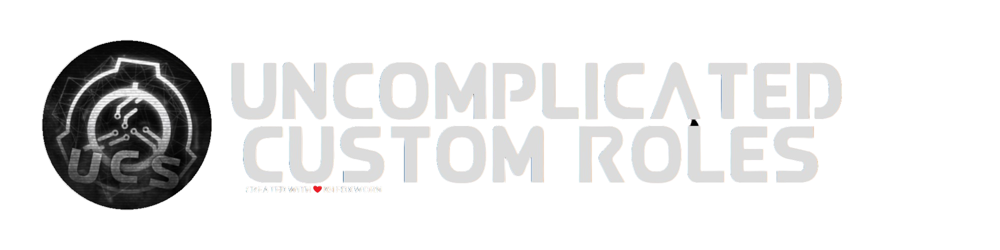

     

  
  <i>Des rôles personnalisés simples, entièrement configurables et personnalisables pour votre serveur SCP:SL !</i>

    
    
    
    

## Prérequis
- **LabAPI** >= `v1.x`
- **Harmony** (`0Harmony.dll`) >= `v2.x`

 

## README traduits
- [**Original** (anglais)](https://github.com/UncomplicatedCustomServer/UncomplicatedCustomRoles/blob/main/README.md)
- [&#x1F1EE;&#x1F1F9; Italiano](https://github.com/UncomplicatedCustomServer/UncomplicatedCustomRoles/blob/main/Localization/README-IT.md)
- [&#127479;&#127482; Русский](https://github.com/UncomplicatedCustomServer/UncomplicatedCustomRoles/blob/main/Localization/README-RU.md)
- [&#127465;&#127466; Deutsch](https://github.com/UncomplicatedCustomServer/UncomplicatedCustomRoles/blob/main/Localization/README-DE.md)
- [&#127477;&#127473; Polski](https://github.com/UncomplicatedCustomServer/UncomplicatedCustomRoles/blob/main/Localization/README-PL.md)
- [🇨🇳 简体中文](https://github.com/UncomplicatedCustomServer/UncomplicatedCustomRoles/blob/main/Localization/README-CN.md)

> [!NOTE]
> Les README traduits sont rédigés et mis à jour par des bénévoles de la communauté : ils peuvent donc avoir un temps de retard sur la version originale.
> Si une traduction oublie quelque chose ou dit autre chose, **c'est le [README anglais](https://github.com/UncomplicatedCustomServer/UncomplicatedCustomRoles/blob/main/README.md) qui fait foi**.

## Qu'est-ce qu'UncomplicatedCustomRoles ?
**UncomplicatedCustomRoles**, ou **UCR**, est un plugin **LabAPI** qui vous permet de créer en YAML des rôles personnalisés entièrement configurables.\
Un rôle personnalisé part d'un rôle classique de SCP:SL et vous laisse en modifier tout ce que vous voulez : points de vie, objets, effets, point d'apparition, équipe, custom info et bien plus encore.\
Avec UCR, vous pouvez régler la quasi-totalité des paramètres de vos rôles et créer tout ce qui vous passe par la tête : la seule limite, c'est votre imagination !

## Fonctionnalités
### 🖥️ Des rôles personnalisés entièrement configurables
Points de vie, AHP, Hume Shield, endurance, taille, pseudo, badge, nom du rôle, custom info, effets, multiplicateur de dégâts, inventaire, munitions, limites d'objets et objets personnalisés : rendez votre serveur SCP:SL unique en son genre !
### 🎯 Une apparition exactement où et quand vous le voulez
Choisissez comment chaque rôle apparaît : dans une salle aléatoire, dans toute une zone, dans des salles précises, sur un point d'apparition enregistré en jeu, à la position d'un autre rôle, dans les cellules des Classe-D, ou tout simplement là où se trouve déjà le joueur.\
Réglez ensuite le moment de l'apparition : probabilité, délai, nombre maximum de joueurs en vie avec ce rôle en même temps, nombre minimum de joueurs sur le serveur, rôles de base qu'il peut remplacer et permission nécessaire pour l'obtenir.
### 🧩 Plus de 25 modules intégrés
Ajoutez des mécaniques supplémentaires à un rôle en une seule ligne de config : résistance aux dégâts, vol de vie, permissions de carte d'accès personnalisées, objets interdits, pacifisme tant que le rôle n'a pas pris de dégâts, pas silencieux, portes Tesla et SCP-096 qui ignorent le rôle, fausse équipe, mise en forme personnalisée du custom info, schematic attaché au joueur, et bien d'autres.
### 🚪 Système d'évasion
Décidez si un rôle peut s'évader et en quel rôle il se transforme ensuite — avec un résultat différent selon qu'il s'est évadé libre ou menotté, et par qui — et laissez-lui garder son inventaire en sortant.
### 🔗 S'entend bien avec vos autres plugins
UCR s'intègre nativement avec **UncomplicatedCustomItems**, **UncomplicatedCustomTeams**, **Exiled CustomItems**, **ScriptedEvents**, **SLWardrobe**, **RespawnTimer** et **LabApiExtensions**.
### 🧪 Validateur de rôles intégré
Chaque rôle est vérifié au moment de son chargement, et UCR vous indique dans la console ce qui ne va pas : une faute de frappe dans une config ne vous gâchera plus une partie.
### ⌨️ Commandes en jeu
Gérez vos rôles personnalisés grâce aux nombreuses commandes intégrées d'UCR :\
`ucr list`, `ucr info`, `ucr role`, `ucr spawn`, `ucr cinfo`, `ucr reload`, `ucr spawnpoint`, `ucr percentages`, `ucr errors`, `ucr generate`, `ucr update`, `ucr version` et bien d'autres.
### 🗂️ Basé sur YAML
Pas besoin de savoir coder pour utiliser UCR : les rôles personnalisés sont créés à l'aide de fichiers `yml` ([YAML](https://fr.wikipedia.org/wiki/YAML)), un langage de sérialisation extrêmement simple et intuitif !
### 📑 Une documentation complète
Consultez la [documentation officielle d'UCR](https://docs.ucr.ucserver.it/) : vous y trouverez tout ce qu'il faut pour utiliser le plugin, des premiers pas jusqu'aux paramètres avancés !
### 🔌 Pensé pour les développeurs
UCR a aussi été conçu pour faciliter la vie des développeurs : s'intégrer au plugin est simple, intuitif et bien documenté !\
[Jetez-y un œil !](https://docs.ucr.ucserver.it/developers/intro)
### 🫂 Une communauté active sur Discord
Rejoignez notre communauté Discord pour discuter avec d'autres utilisateurs, et même avec les développeurs !\
Échangez, demandez de l'aide, partagez vos connaissances et vos rôles : vous êtes les bienvenus !

## Bugs et feuille de route
Pour suivre les bugs et la feuille de route d'UCR, l'UCSC met à disposition une instance FlySpray.\
[bugs.ucserver.it](https://bugs.ucserver.it/index.php?project=2&do=index&switch=1)

## Installation
Consultez la [documentation](https://docs.ucr.ucserver.it/getting-started/installation).

## Si vous utilisez UCR, pensez à faire un don
UCR est un plugin développé par **UCS Collective**.\
Tous nos plugins sont **gratuits** et **open source**, et le resteront toujours.\
Ce qu'ils nous coûtent, c'est du temps : le temps passé à écrire le plugin, à répondre à vos questions sur Discord et à tout maintenir en état de marche après chaque mise à jour de SCP:SL.\
Si UCR tourne sur votre serveur, **pensez à faire un don via OpenCollective** : chaque contribution, même petite, est directement réinvestie dans les plugins que vous utilisez.

<a href="https://opencollective.com/ucs">&nbsp;&nbsp;Faire un don</a>

## Contacts
### UCS - UncomplicatedCustomServer
  **Discord :** [https://discord.gg/5StRGu8EJV](https://discord.gg/5StRGu8EJV)

### FoxWorn3365
  **Discord :** `@foxworn`\
  **E-mail :** `foxworn3365@gmail.com`
### MedveMarci
  **Discord :** `medvemarci`
### Dr.Agenda
  **Discord :** `dr.agenda`

## Crédits de traduction
**Français :** `@robocnop`\
**Italien :** `@foxworn`\
**Russe :** `@naxefir`\
**Allemand :** `@seekedstroy`\
**Polonais :** `@.piwnica2137`\
**Chinois simplifié :** `@Raiden-Yayi`
